# Kilometro

**A vehicle maintenance and fuel tracker.** Kilometro records each vehicle's services, fuel fill-ups and other
expenses, works out from the odometer readings when each service is next due, and computes fuel efficiency, cost
per kilometer and the month the vehicle's registration is due for renewal.

CTADWEBL Final Project (Proposal 2: Kilometro).

## Group members

| Member |
|---|
| Sabaten, David Joshua L. |
| Cabrera, Kurt Sebastien D. |
| Muldong, Kurt Wayne M. |
| Quintanilla, Dirk Dawkins D. |

## Concept

Most vehicle owners keep track of their change oil with a small sticker on the windshield, if at all. Other services
such as tire rotation, brake checks and air filter replacement are easy to forget until something breaks, and a missed
service usually turns into a more expensive repair. Fuel and repair receipts are scattered, so owners cannot tell how
much a vehicle really costs to run. The problem grows for a small business with several delivery motorcycles.

**Target users**

- Vehicle owners who want to keep one or more personal vehicles in good condition.
- Small fleet managers, for example a small delivery business with several motorcycles, who need to see which
  vehicles are due for service and which ones cost the most to run.

## What the application does

- Records each vehicle's services, fuel fill-ups and other expenses.
- Works out from the odometer readings when each service is next due, by distance or by time, whichever comes first.
- Computes fuel efficiency, cost per kilometer and the month the vehicle's registration is due for renewal.

### Data it processes

Six MongoDB collections, all with `createdAt` / `updatedAt` timestamps:

| Collection | What it holds | Main fields |
|---|---|---|
| `owners` | People or businesses that own vehicles | `fullName`, `email` (optional, unique), `contactNumber` (`09` + 9 digits), `type` (`individual` / `business`) |
| `vehicles` (main) | Each car or motorcycle | `owner`, `plateNumber` (unique), `make`, `model`, `year`, `type` (`motorcycle` / `car` / `suv` / `van` / `truck`), `fuelType` (`gasoline` / `diesel`), `startingOdometer`, `status` (`active` / `in_shop` / `retired`, default `active`) |
| `serviceTypes` | Kinds of maintenance and how often they are needed | `name` (unique), `intervalKm`, `intervalMonths` (0–60), `appliesTo` (vehicle types); at least one interval above 0 |
| `serviceLogs` | Services done on a vehicle | `vehicle`, `serviceType`, `date` (not in the future), `odometer`, `cost`, `shop` |
| `fuelLogs` | Fuel fill-ups | `vehicle`, `date`, `odometer`, `liters` (0.1–200), `pricePerLiter` (at least 1), `fullTank` (default `true`) |
| `expenses` | Other costs of owning the vehicle | `vehicle`, `date`, `category` (`registration` / `insurance` / `parts` / `parking` / `toll` / `wash` / `other`), `amount` |

## Screenshots

All screenshots were taken from the running application with the seed data (`docs/screenshots/`).

| | |
|---|---|
| **Landing page** 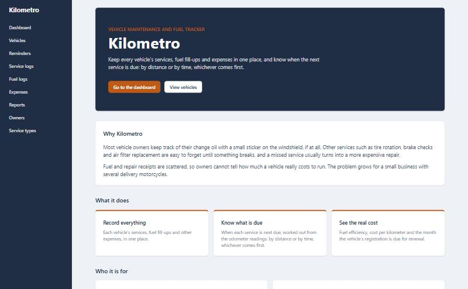 | **Dashboard** 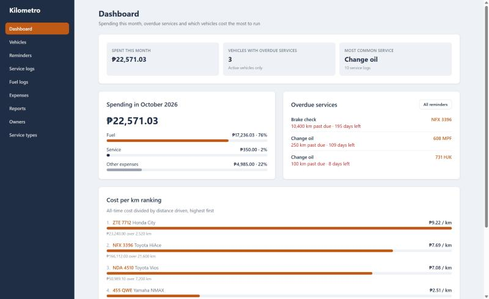 |
| **Vehicles, with filters** 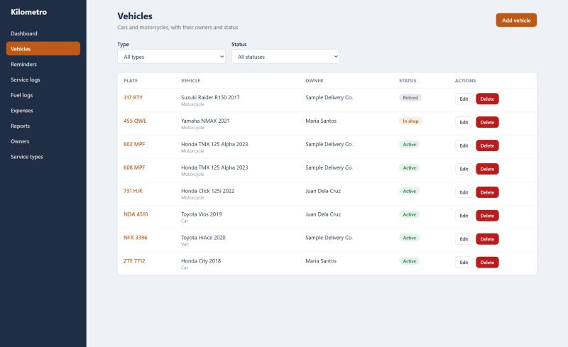 | **Vehicle details: schedule and fuel efficiency** 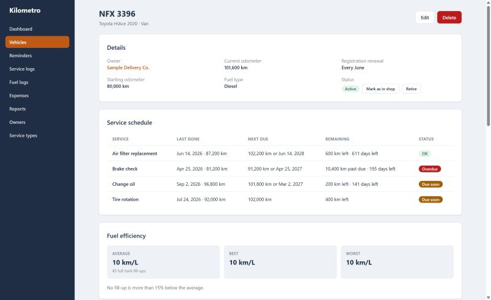 |
| **Vehicle details: cost report** 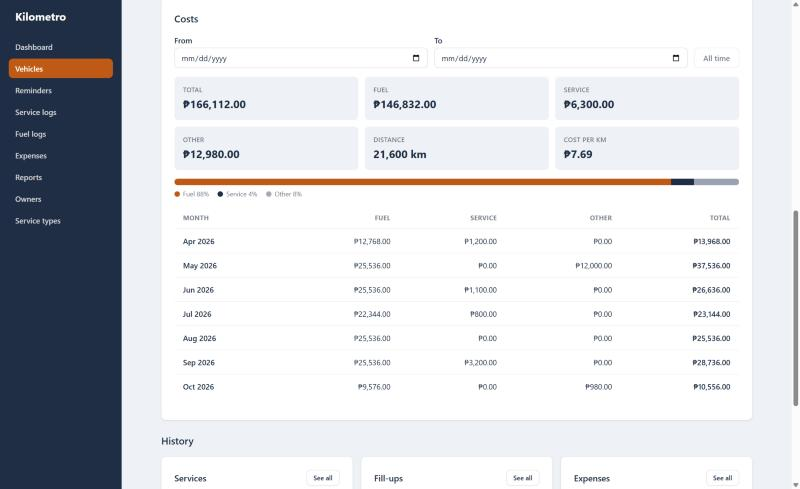 | **Reminders** 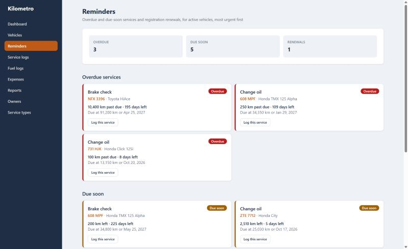 |
| **Fuel logs: a flagged fill-up** 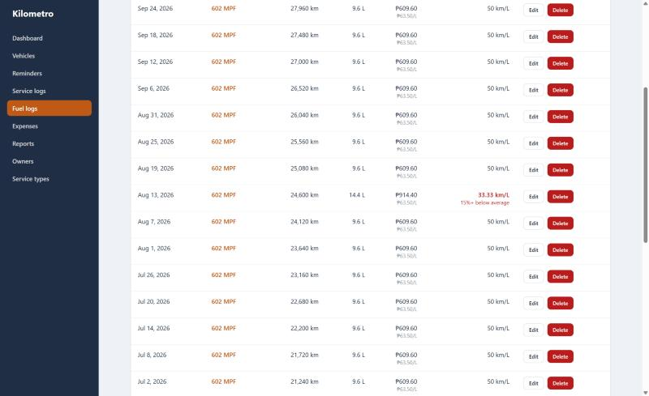 | **Reports** 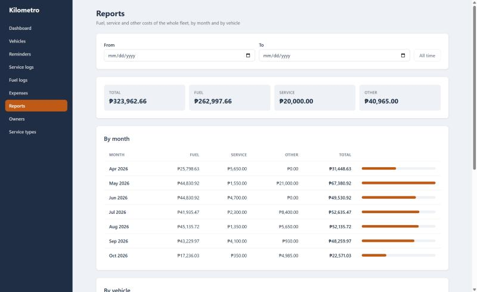 |
| **Odometer rule: the server's 400 shown in the form** 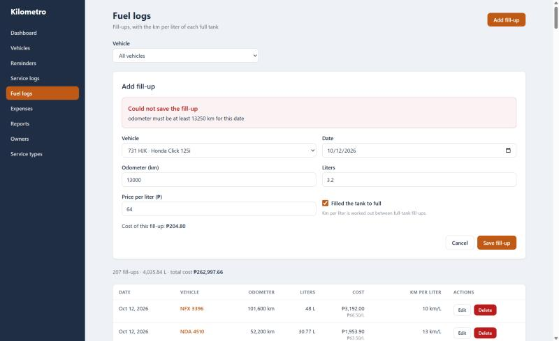 | **Vehicle not found** 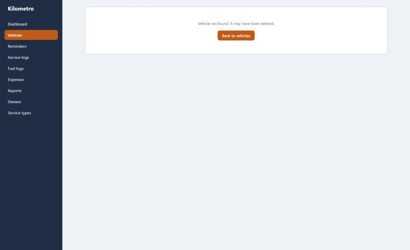 |

At 375px wide (phone):

| | |
|---|---|
| **Dashboard** 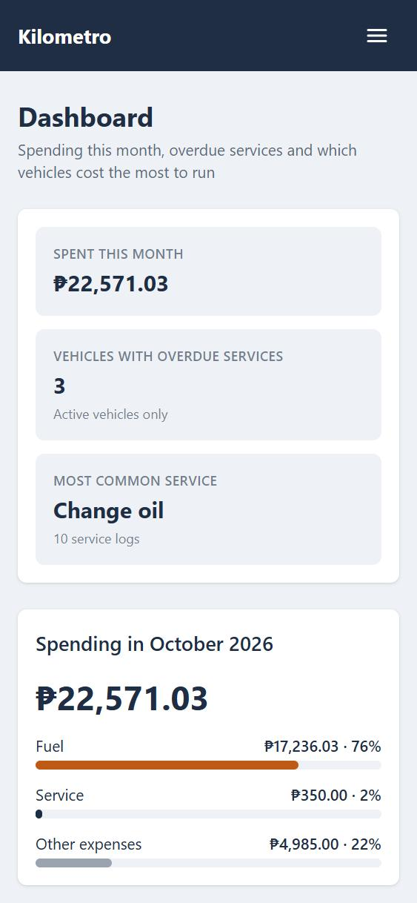 | **Navigation menu** 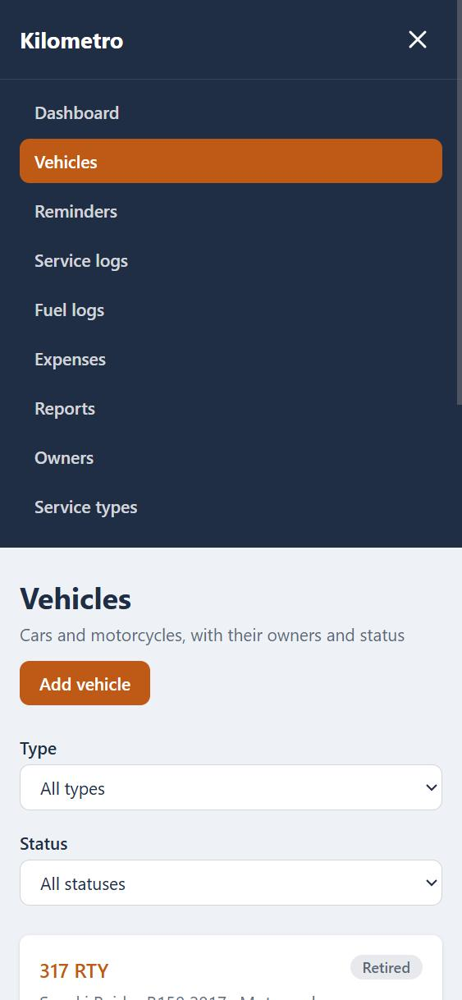 |

## Features

**Processing rules (server)**

| Feature | What it does | Endpoint |
|---|---|---|
| Service schedule | For each service type that applies to the vehicle, next due km = last km + interval, next due date = last date + interval months. **Overdue** when either limit is reached, **due soon** within 500 km or 14 days, otherwise **OK**. | `GET /api/vehicles/:id/service-schedule` |
| Reminders | Overdue and due-soon services and registration renewals for all active vehicles, most urgent first. | `GET /api/reminders` |
| Registration renewal | Renewal month from the last digit of the plate number (1 = January … 9 = September, 0 = October). | Vehicle details and reminders |
| Odometer rule | A fuel or service log cannot be lower than an earlier log or higher than a later one; logs for retired vehicles are refused. | `POST`/`PUT` fuel and service logs |
| Fuel efficiency | Km per liter between full-tank fill-ups, with the average, best and worst, and a flag on fill-ups more than 15% below the average. | `GET /api/vehicles/:id/fuel-efficiency` |
| Cost report | Fuel, service and other costs for a date range, a monthly breakdown and cost per kilometer. | `GET /api/vehicles/:id/costs` |
| Fleet statistics | Spending this month, vehicles ranked by cost per km, the most common service and the number of vehicles with overdue services. | `GET /api/stats/fleet` |
| Vehicle status rules | active ↔ in_shop, active / in_shop → retired; a retired vehicle stays retired. | `PATCH /api/vehicles/:id/status` |

**Pages (client)**

| Page | Route |
|---|---|
| Landing page | `/` |
| Dashboard: spending this month, overdue services, cost per km ranking | `/dashboard` |
| Vehicles, with type and status filters | `/vehicles` |
| Vehicle details: schedule, fuel efficiency, costs and history, status changes | `/vehicles/:id` |
| Add or edit vehicle | `/vehicles/new`, `/vehicles/:id/edit` |
| Service logs, with add and edit forms | `/service-logs` |
| Fuel logs, with the km per liter of each fill-up | `/fuel-logs` |
| Expenses, with vehicle and category filters | `/expenses` |
| Reminders | `/reminders` |
| Owners and each owner's vehicles, with add and edit forms | `/owners`, `/owners/:id` |
| Service types | `/service-types` |
| Reports: cost breakdown by month and by vehicle | `/reports` |
| Not found | any other URL |

**Interface**

- Forms use React Hook Form with Zod schemas (in `client/src/schemas/`); every field shows its own error, the submit
  button is disabled while saving, and the server's 400 message is shown in the form.
- Every delete asks for confirmation; create, update and delete show a toast.
- Every page that loads data has loading, error and empty states; detail pages show "not found" for a 404.
- One axios instance (`client/src/api/axios.ts`) and a custom `useApi` hook (`client/src/hooks/useApi.ts`).
- Theme colors defined with Tailwind `@theme`: orange `#BF5A16`, navy `#1F2D45`, surface `#EEF2F6`, and status colors
  for overdue `#B91C1C`, due soon `#A16207` and OK `#15803D`.
- Usable at 375px: tables become stacked cards below the `md` breakpoint and the navigation becomes a menu.

## Tech stack

- **Client:** React (Vite) with TypeScript, Tailwind CSS v4, React Router, React Hook Form, Zod, axios
- **Server:** Node.js, Express, MongoDB Atlas with Mongoose, `cors`, `dotenv`

```
kilometro/
  server/   Express API: config/, models/, routes/, middleware/, services/ (processing rules), seed/
  client/   React app: src/api/, hooks/, components/, pages/, schemas/, types/, utils/
  docs/screenshots/
```

## Setup

Developed and tested with Node.js 24 and npm 11. You also need a MongoDB Atlas cluster (or any MongoDB server).

### 1. Server

```bash
cd server
npm install
cp .env.example .env
```

Fill in `server/.env`:

| Variable | Meaning | Example |
|---|---|---|
| `PORT` | Port of the API | `5000` |
| `MONGO_URI` | MongoDB connection string, with the database name `kilometro` | `mongodb+srv://<username>:<password>@<cluster-host>/kilometro` |
| `CLIENT_ORIGIN` | Address of the client, allowed by CORS | `http://localhost:5173` |

Load the sample data and start the API:

```bash
npm run seed
npm run dev
```

`npm run seed` clears all six collections and inserts 3 owners, 8 vehicles, 4 service types and about six months of
service logs, fill-ups and expenses. Its dates are counted back from the day it runs. `npm start` runs the API without
watching for changes.

### 2. Client

```bash
cd client
npm install
cp .env.example .env
npm run dev
```

`client/.env` has one variable:

| Variable | Meaning | Example |
|---|---|---|
| `VITE_API_URL` | Base address of the API | `http://localhost:5000/api` |

Open http://localhost:5173. `npm run build` and `npm run lint` check the client.

**Troubleshooting:** if the server stops with `querySrv ECONNREFUSED`, Node.js could not look up the `mongodb+srv://`
address on that computer. In MongoDB Atlas, copy the standard connection string (the one that starts with
`mongodb://` and lists the cluster hosts) into `MONGO_URI` instead.

## API documentation

Base URL: `http://localhost:5000`. Requests and responses are JSON.

- Status codes: **200** read, update and delete; **201** create; **400** validation error, invalid ID, broken rule or
  duplicate value; **404** record or route not found; **500** unexpected error.
- Every error is `{ "message": "..." }`.

The samples below were taken from the running API with the seed data. Responses are shortened: `createdAt`,
`updatedAt` and `__v` are left out, and long lists show their first item followed by how many more there are.

### Endpoints (34)

| # | Method | Path | Purpose | Sample request | Sample response |
|---|---|---|---|---|---|
| 1 | GET | `/api/vehicles` | List vehicles, filters ?type=&status=&owner= (D17) | `GET /api/vehicles?type=car&status=active` | 200 `[{"_id":"6acc6336cd14686b7183be67","owner":{"_id":"6acc6336cd14686b7183be60","fullName":"Juan Dela Cruz"},"plateNumber":"NDA 4510","make":"Toyota","model":"Vios","year":2019,"type":"car","fuelType":"gasoline","startingOdometer":45000,"status":"active"},"… 1 more"]` |
| 2 | GET | `/api/vehicles/:id` | Get one vehicle with owner, currentOdometer and registrationMonth (D18) | `GET /api/vehicles/6acc6336cd14686b7183be67` | 200 `{"_id":"6acc6336cd14686b7183be67","owner":{"_id":"6acc6336cd14686b7183be60","fullName":"Juan Dela Cruz","email":"juan.delacruz@example.com","contactNumber":"09170000001","type":"individual"},"plateNumber":"NDA 4510","make":"Toyota","model":"Vios","year":2019,"type":"car","fuelType":"gasoline","startingOdometer":45000,"status":"active","currentOdometer":52200,"registrationMonth":"October"}` |
| 3 | POST | `/api/vehicles` | Create a vehicle (D1, D15) | `POST /api/vehicles {"owner":"6accf7f113041665d5adb9ed","plateNumber":"abc 1234","make":"Toyota","model":"Wigo","year":2021,"type":"car","fuelType":"gasoline","startingOdometer":1000}` | 201 `{"owner":"6accf7f113041665d5adb9ed","plateNumber":"ABC 1234","make":"Toyota","model":"Wigo","year":2021,"type":"car","fuelType":"gasoline","startingOdometer":1000,"status":"active","_id":"6accf7f213041665d5adb9ee"}` |
| 4 | PUT | `/api/vehicles/:id` | Update a vehicle; status is ignored (D11) | `PUT /api/vehicles/6accf7f213041665d5adb9ee {"owner":"6accf7f113041665d5adb9ed","plateNumber":"ABC 1234","make":"Toyota","model":"Wigo G","year":2021,"type":"car","fuelType":"gasoline","startingOdometer":1000}` | 200 `{"owner":"6accf7f113041665d5adb9ed","plateNumber":"ABC 1234","make":"Toyota","model":"Wigo G","year":2021,"type":"car","fuelType":"gasoline","startingOdometer":1000,"status":"active","_id":"6accf7f213041665d5adb9ee"}` |
| 5 | DELETE | `/api/vehicles/:id` | Delete a vehicle and its logs and expenses (D12) | `DELETE /api/vehicles/6accf7f213041665d5adb9ee` | 200 `{"message":"Vehicle deleted, along with 0 service log(s), 0 fuel log(s) and 1 expense(s)"}` |
| 6 | PATCH | `/api/vehicles/:id/status` | Change status: active ↔ in_shop, → retired (D11) | `PATCH /api/vehicles/6accf7f213041665d5adb9ee/status {"status":"in_shop"}` | 200 `{"_id":"6accf7f213041665d5adb9ee","owner":"6accf7f113041665d5adb9ed","plateNumber":"ABC 1234","make":"Toyota","model":"Wigo G","year":2021,"type":"car","fuelType":"gasoline","startingOdometer":1000,"status":"in_shop"}` |
| 7 | GET | `/api/vehicles/:id/service-schedule` | When each service is next due and its status (D6) | `GET /api/vehicles/6acc6336cd14686b7183be6e/service-schedule` | 200 `{"currentOdometer":101600,"items":[{"serviceType":{"_id":"6acc6336cd14686b7183be66","name":"Air filter replacement","intervalKm":15000,"intervalMonths":24},"lastServiceLogId":"6acc6336cd14686b7183bf53","lastKm":87200,"lastDate":"2026-06-14T00:00:00.000Z","nextDueKm":102200,"nextDueDate":"2028-06-14T00:00:00.000Z","kmRemaining":600,"daysRemaining":611,"status":"ok"},"… 3 more"]}` |
| 8 | GET | `/api/vehicles/:id/fuel-efficiency` | Km per liter between full tanks; average, best, worst, flags (D8) | `GET /api/vehicles/6acc6336cd14686b7183be6b/fuel-efficiency` | 200 `{"average":49.44,"best":50,"worst":33.33,"entries":[{"fuelLogId":"6acc6336cd14686b7183bebe","date":"2026-04-21T00:00:00.000Z","odometer":15480,"kmPerLiter":50,"flagged":false},"… 29 more"]}` |
| 9 | GET | `/api/vehicles/:id/costs` | Cost report for an optional ?from=&to= range (D9) | `GET /api/vehicles/6acc6336cd14686b7183be67/costs?from=2026-09-01&to=2026-09-30` | 200 `{"from":"2026-09-01T00:00:00.000Z","to":"2026-09-30T00:00:00.000Z","fuel":5861.7,"service":900,"other":120,"total":6881.7,"monthly":[{"month":"2026-09","fuel":5861.7,"service":900,"other":120,"total":6881.7}],"distance":1200,"costPerKm":5.73}` |
| 10 | GET | `/api/owners` | List all owners | `GET /api/owners` | 200 `[{"_id":"6acc6336cd14686b7183be60","fullName":"Juan Dela Cruz","email":"juan.delacruz@example.com","contactNumber":"09170000001","type":"individual"},"… 2 more"]` |
| 11 | GET | `/api/owners/:id` | Get one owner | `GET /api/owners/6acc6336cd14686b7183be60` | 200 `{"_id":"6acc6336cd14686b7183be60","fullName":"Juan Dela Cruz","email":"juan.delacruz@example.com","contactNumber":"09170000001","type":"individual"}` |
| 12 | POST | `/api/owners` | Create an owner (D2, D3) | `POST /api/owners {"fullName":"Ana Reyes","email":"ana.reyes@example.com","contactNumber":"09171112222","type":"individual"}` | 201 `{"fullName":"Ana Reyes","email":"ana.reyes@example.com","contactNumber":"09171112222","type":"individual","_id":"6accf7f113041665d5adb9ed"}` |
| 13 | PUT | `/api/owners/:id` | Update an owner | `PUT /api/owners/6accf7f113041665d5adb9ed {"fullName":"Ana Reyes","contactNumber":"09171113333","type":"individual"}` | 200 `{"fullName":"Ana Reyes","contactNumber":"09171113333","type":"individual","_id":"6accf7f113041665d5adb9ed"}` |
| 14 | DELETE | `/api/owners/:id` | Delete an owner who has no vehicles (D12) | `DELETE /api/owners/6accf7f113041665d5adb9ed` | 200 `{"message":"Owner deleted"}` |
| 15 | GET | `/api/service-types` | List service types | `GET /api/service-types` | 200 `[{"_id":"6acc6336cd14686b7183be66","name":"Air filter replacement","intervalKm":15000,"intervalMonths":24,"appliesTo":["motorcycle","… 4 more"]},"… 3 more"]` |
| 16 | POST | `/api/service-types` | Create a service type (at least one interval) | `POST /api/service-types {"name":"Wheel alignment","intervalKm":10000,"appliesTo":["car","suv"]}` | 201 `{"name":"Wheel alignment","intervalKm":10000,"appliesTo":["car","… 1 more"],"_id":"6accf7f313041665d5adb9ef"}` |
| 17 | PUT | `/api/service-types/:id` | Update a service type | `PUT /api/service-types/6accf7f313041665d5adb9ef {"name":"Wheel alignment","intervalKm":10000,"intervalMonths":12,"appliesTo":["car","suv","van"]}` | 200 `{"name":"Wheel alignment","intervalKm":10000,"intervalMonths":12,"appliesTo":["car","… 2 more"],"_id":"6accf7f313041665d5adb9ef"}` |
| 18 | DELETE | `/api/service-types/:id` | Delete a service type that no log uses (D12) | `DELETE /api/service-types/6accf7f313041665d5adb9ef` | 200 `{"message":"Service type deleted"}` |
| 19 | GET | `/api/service-logs` | List service logs, filter ?vehicle= (D17) | `GET /api/service-logs?vehicle=6acc6336cd14686b7183be67` | 200 `[{"_id":"6acc6336cd14686b7183bf40","vehicle":{"_id":"6acc6336cd14686b7183be67","plateNumber":"NDA 4510","make":"Toyota","model":"Vios"},"serviceType":{"_id":"6acc6336cd14686b7183be65","name":"Brake check"},"date":"2026-09-12T00:00:00.000Z","odometer":51000,"cost":900,"shop":"Dealer service center"},"… 2 more"]` |
| 20 | GET | `/api/service-logs/:id` | Get one service log | `GET /api/service-logs/6accf7f413041665d5adb9f0` | 200 `{"_id":"6accf7f413041665d5adb9f0","vehicle":{"_id":"6accf7f213041665d5adb9ee","plateNumber":"ABC 1234","make":"Toyota","model":"Wigo G"},"serviceType":{"_id":"6accf7f313041665d5adb9ef","name":"Wheel alignment"},"date":"2026-10-01T00:00:00.000Z","odometer":1500,"cost":800,"shop":"Sample shop"}` |
| 21 | POST | `/api/service-logs` | Create a service log (D5 odometer rule, D13) | `POST /api/service-logs {"vehicle":"6accf7f213041665d5adb9ee","serviceType":"6accf7f313041665d5adb9ef","date":"2026-10-01","odometer":1500,"cost":800,"shop":"Sample shop"}` | 201 `{"vehicle":"6accf7f213041665d5adb9ee","serviceType":"6accf7f313041665d5adb9ef","date":"2026-10-01T00:00:00.000Z","odometer":1500,"cost":800,"shop":"Sample shop","_id":"6accf7f413041665d5adb9f0"}` |
| 22 | PUT | `/api/service-logs/:id` | Update a service log (D5, D13) | `PUT /api/service-logs/6accf7f413041665d5adb9f0 {"vehicle":"6accf7f213041665d5adb9ee","serviceType":"6accf7f313041665d5adb9ef","date":"2026-10-01","odometer":1500,"cost":850,"shop":"Sample shop"}` | 200 `{"vehicle":"6accf7f213041665d5adb9ee","serviceType":"6accf7f313041665d5adb9ef","date":"2026-10-01T00:00:00.000Z","odometer":1500,"cost":850,"shop":"Sample shop","_id":"6accf7f413041665d5adb9f0"}` |
| 23 | DELETE | `/api/service-logs/:id` | Delete a service log | `DELETE /api/service-logs/6accf7f413041665d5adb9f0` | 200 `{"message":"Service log deleted"}` |
| 24 | GET | `/api/fuel-logs` | List fill-ups, filter ?vehicle= (D17) | `GET /api/fuel-logs?vehicle=6acc6336cd14686b7183be67` | 200 `[{"_id":"6acc6336cd14686b7183be82","vehicle":{"_id":"6acc6336cd14686b7183be67","plateNumber":"NDA 4510","make":"Toyota","model":"Vios"},"date":"2026-10-12T00:00:00.000Z","odometer":52200,"liters":30.77,"pricePerLiter":63.5,"fullTank":true},"… 19 more"]` |
| 25 | GET | `/api/fuel-logs/:id` | Get one fill-up | `GET /api/fuel-logs/6accf7f413041665d5adb9f1` | 200 `{"_id":"6accf7f413041665d5adb9f1","vehicle":{"_id":"6accf7f213041665d5adb9ee","plateNumber":"ABC 1234","make":"Toyota","model":"Wigo G"},"date":"2026-10-05T00:00:00.000Z","odometer":1800,"liters":25,"pricePerLiter":63.5,"fullTank":true}` |
| 26 | POST | `/api/fuel-logs` | Create a fill-up (D5, D14) | `POST /api/fuel-logs {"vehicle":"6accf7f213041665d5adb9ee","date":"2026-10-05","odometer":1800,"liters":25,"pricePerLiter":63.5,"fullTank":true}` | 201 `{"vehicle":"6accf7f213041665d5adb9ee","date":"2026-10-05T00:00:00.000Z","odometer":1800,"liters":25,"pricePerLiter":63.5,"fullTank":true,"_id":"6accf7f413041665d5adb9f1"}` |
| 27 | PUT | `/api/fuel-logs/:id` | Update a fill-up (D5, D14) | `PUT /api/fuel-logs/6accf7f413041665d5adb9f1 {"vehicle":"6accf7f213041665d5adb9ee","date":"2026-10-05","odometer":1820,"liters":25,"pricePerLiter":63.5,"fullTank":true}` | 200 `{"vehicle":"6accf7f213041665d5adb9ee","date":"2026-10-05T00:00:00.000Z","odometer":1820,"liters":25,"pricePerLiter":63.5,"fullTank":true,"_id":"6accf7f413041665d5adb9f1"}` |
| 28 | DELETE | `/api/fuel-logs/:id` | Delete a fill-up | `DELETE /api/fuel-logs/6accf7f413041665d5adb9f1` | 200 `{"message":"Fuel log deleted"}` |
| 29 | GET | `/api/expenses` | List expenses, filters ?vehicle=&category= (D17) | `GET /api/expenses?vehicle=6acc6336cd14686b7183be6e&category=toll` | 200 `[{"_id":"6acc6337cd14686b7183bf66","vehicle":{"_id":"6acc6336cd14686b7183be6e","plateNumber":"NFX 3396","make":"Toyota","model":"HiAce"},"date":"2026-10-10T00:00:00.000Z","category":"toll","amount":310},"… 1 more"]` |
| 30 | POST | `/api/expenses` | Create an expense (D14) | `POST /api/expenses {"vehicle":"6accf7f213041665d5adb9ee","date":"2026-10-06","category":"parking","amount":80}` | 201 `{"vehicle":"6accf7f213041665d5adb9ee","date":"2026-10-06T00:00:00.000Z","category":"parking","amount":80,"_id":"6accf7f513041665d5adb9f2"}` |
| 31 | PUT | `/api/expenses/:id` | Update an expense | `PUT /api/expenses/6accf7f513041665d5adb9f2 {"vehicle":"6accf7f213041665d5adb9ee","date":"2026-10-06","category":"parking","amount":100}` | 200 `{"vehicle":"6accf7f213041665d5adb9ee","date":"2026-10-06T00:00:00.000Z","category":"parking","amount":100,"_id":"6accf7f513041665d5adb9f2"}` |
| 32 | DELETE | `/api/expenses/:id` | Delete an expense | `DELETE /api/expenses/6accf7f513041665d5adb9f2` | 200 `{"message":"Expense deleted"}` |
| 33 | GET | `/api/reminders` | Overdue / due-soon services and registration renewals, most urgent first (D7) | `GET /api/reminders` | 200 `[{"kind":"service","status":"overdue","vehicle":{"_id":"6acc6336cd14686b7183be6e","plateNumber":"NFX 3396","make":"Toyota","model":"HiAce"},"serviceType":{"_id":"6acc6336cd14686b7183be65","name":"Brake check","intervalKm":10000,"intervalMonths":12},"nextDueKm":91200,"nextDueDate":"2027-04-25T00:00:00.000Z","kmRemaining":-10400,"daysRemaining":195,"shareLeft":-1.04},"… 8 more"]` |
| 34 | GET | `/api/stats/fleet` | Spending this month, cost per km ranking, most common service, overdue count (D10) | `GET /api/stats/fleet` | 200 `{"spendingThisMonth":{"fuel":17236.03,"service":350,"other":4985,"total":22571.03},"ranking":[{"vehicle":{"_id":"6acc6336cd14686b7183be69","plateNumber":"ZTE 7712","make":"Honda","model":"City","status":"active"},"totalCost":23240,"distance":2520,"costPerKm":9.22},"… 6 more"],"mostCommonService":{"serviceType":{"_id":"6acc6336cd14686b7183be63","name":"Change oil"},"count":10},"overdueVehicles":3}` |

### Error examples

| Case | Request | Response |
|---|---|---|
| Odometer rule (D5) | `POST /api/fuel-logs {"vehicle":"6accf7f213041665d5adb9ee","date":"2026-10-06","odometer":1700,"liters":10,"pricePerLiter":63.5}` | 400 `{"message":"odometer must be at least 1820 km for this date"}` |
| Validation error | `POST /api/owners {"fullName":"","contactNumber":"12345"}` | 400 `` {"message":"Path `fullName` is required. contactNumber must be 11 digits starting with 09."} `` |
| Duplicate key | `POST /api/vehicles {"owner":"6accf7f113041665d5adb9ed","plateNumber":"ABC 1234","make":"X","model":"Y","type":"car","startingOdometer":0}` | 400 `{"message":"plateNumber already exists"}` |
| Invalid ID | `GET /api/vehicles/abc` | 400 `{"message":"Invalid ID"}` |
| Record not found | `GET /api/vehicles/000000000000000000000000` | 404 `{"message":"Vehicle not found"}` |
| Unknown route | `GET /api/nothing` | 404 `{"message":"Route not found: GET /api/nothing"}` |
| Status rule (D11) | `PATCH /api/vehicles/6accf7f213041665d5adb9ee/status {"status":"active"}` | 400 `{"message":"Vehicle is already active"}` |
| Delete rule (D12) | `DELETE /api/owners/6accf7f113041665d5adb9ed` | 400 `{"message":"This owner still has 1 vehicle(s). Delete them or move them to another owner first."}` |

## Known limitations and assumptions

These are the details the proposal did not specify, and how Kilometro handles them.

- **D1 Plate number and renewal month.** Plate numbers are stored trimmed and uppercase: 4 to 10 characters, letters
  and digits separated by single spaces or dashes, with at least one digit. The renewal month uses the last digit in
  the plate: 1 = January … 9 = September, 0 = October.
- **D2 Contact number.** Philippine mobile format: `09` followed by 9 digits.
- **D3 Owner email.** Optional; when given it must be a valid email and unique.
- **D4 Current odometer.** The highest reading among the vehicle's fuel logs and service logs, or its starting
  odometer when it has none.
- **D5 Odometer rule.** Applies to adding and editing fuel and service logs; a log being edited is not compared with
  itself. A reading must be at least every reading dated before it (and the starting odometer) and at most every
  reading dated after it, across both fuel and service logs. Logs on the same date are not compared. Logs of a retired
  vehicle are refused. Every refusal is a 400 that states the allowed range.
- **D6 Service schedule.** Only service types that apply to the vehicle's type are used. Without a log, the service is
  counted from the starting odometer and the day the vehicle was added. A limit the service type does not have is
  ignored. Overdue when km remaining ≤ 0 or days remaining ≤ 0; due soon when km remaining ≤ 500 or days remaining ≤ 14.
- **D7 Reminders.** Only active vehicles. Service items are the overdue and due-soon schedule rows; registration items
  are renewals due this month or next month. Order: overdue services, due-soon services, registrations due this month,
  registrations due next month.
- **D8 Fuel efficiency.** Fill-ups are sorted by odometer. For each full tank after the first, km per liter = distance
  since the previous full tank ÷ liters added since then (partial fills included), rounded to 2 decimals. A fill-up is
  flagged when it is below 85% of the average. With fewer than two full tanks the answer is `average: null` and
  "Need at least two full-tank fill-ups".
- **D9 Cost report.** `from` and `to` are optional dates (with neither, all time). Distance = highest reading in the
  range − highest reading before it (or the starting odometer). Cost per km is `null` when no distance was driven.
  Invalid dates, or `from` after `to`, are a 400.
- **D10 Fleet statistics.** Spending this month counts every record dated in the current calendar month. The ranking
  covers vehicles that are not retired and have driven some distance, highest cost per km first. The overdue count
  covers active vehicles.
- **D11 Status changes.** Allowed: active → in_shop, in_shop → active, active → retired, in_shop → retired. Changing to
  the same status or away from retired is a 400. `PUT /api/vehicles/:id` ignores `status`.
- **D12 Deletes.** An owner who still has vehicles, and a service type used by service logs, cannot be deleted (400).
  Deleting a vehicle also deletes its service logs, fuel logs and expenses, and the answer says how many.
- **D13 Service type check.** A service log whose service type does not apply to the vehicle's type is a 400.
- **D14 Dates.** Service log, fuel log and expense dates cannot be in the future.
- **D15 Year.** The latest allowed `year` is the current year + 1, worked out each time a vehicle is validated.
- **D16 Units.** Money in Philippine pesos (₱, 2 decimals), distance in km, fuel in liters; formatting happens in the
  client.
- **D17 List filters.** `GET /api/vehicles?type=&status=&owner=`, `GET /api/service-logs?vehicle=`,
  `GET /api/fuel-logs?vehicle=`, `GET /api/expenses?vehicle=&category=`. An invalid ID in a filter is a 400.
- **D18 Vehicle details.** `GET /api/vehicles/:id` includes the full owner, `currentOdometer` and
  `registrationMonth`.
- **D19 Extra required fields.** `vehicles.type`, `vehicles.startingOdometer`, `fuelLogs.liters`,
  `fuelLogs.pricePerLiter`, `expenses.category` and `expenses.amount` are required, because the processing rules need
  them.
- **D20 Reminder urgency.** Inside the overdue and due-soon groups, reminders are ordered by the share of the interval
  left: the smaller of km remaining ÷ interval km and days remaining ÷ (interval months × 30.44). Lower comes first,
  so a service 500 km past a 5,000 km interval (−10%) ranks after one 41 days past a 12-month interval (−11%).
- **D21 Money in centavos.** Each fill-up's cost (liters × price per liter), service cost and expense amount is rounded
  to the centavo before it is added up, so totals by month, by vehicle and for the whole fleet always match.

Other assumptions:

- Dates are chosen as whole days and stored as midnight UTC of that day; any time on today's date is accepted.
- A log or expense must point to a vehicle (and a service log to a service type) that exists, and a vehicle to an
  existing owner; otherwise the answer is a 400.
- Expenses can still be added for a retired vehicle (the odometer rule only covers fuel and service logs).
- The seed makes one registration due this month or next month by choosing a plate digit for the current month.
  No digit maps to November or December, so when the seed runs in November that demo case is missing.
- There is no login, payment, deployment or file upload; these are outside the project's scope.
